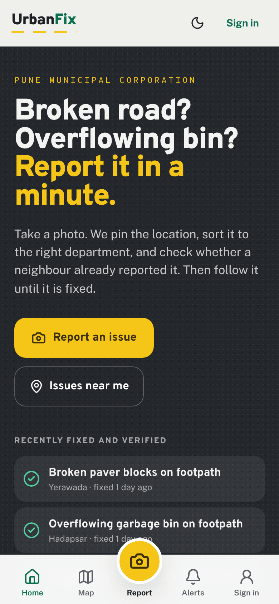
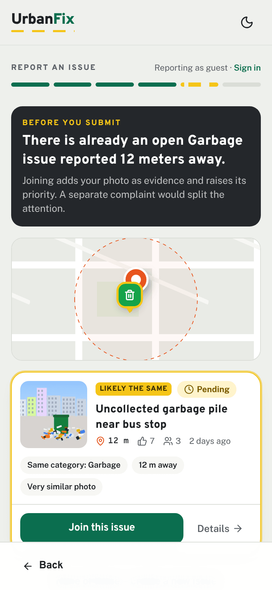
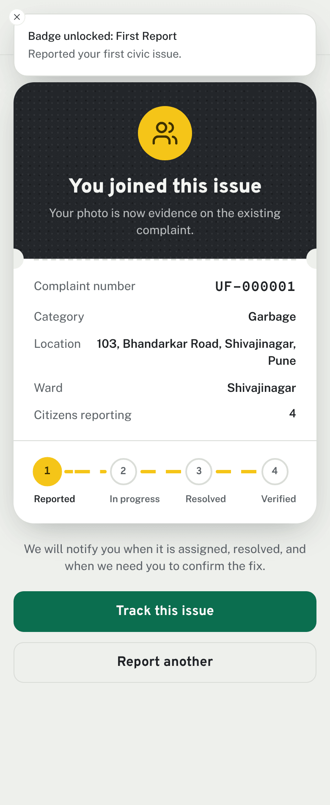
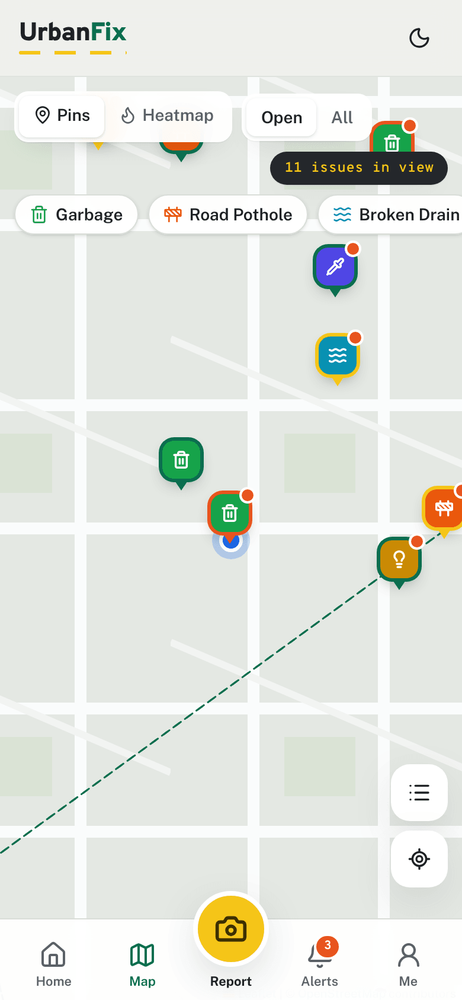
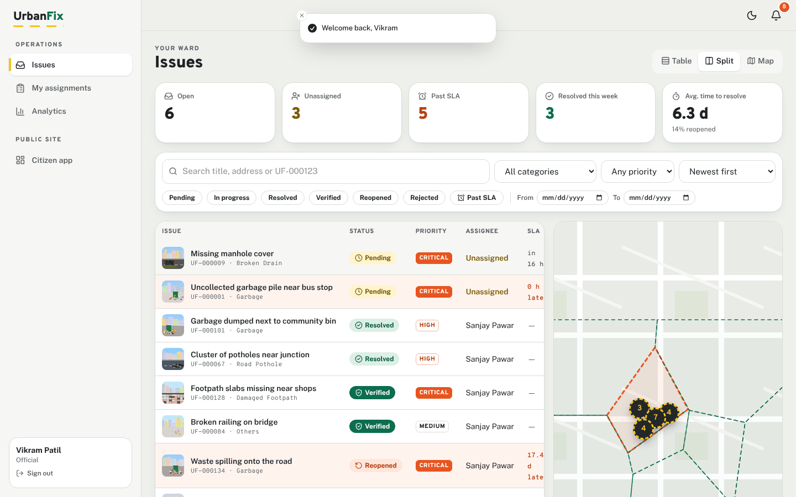
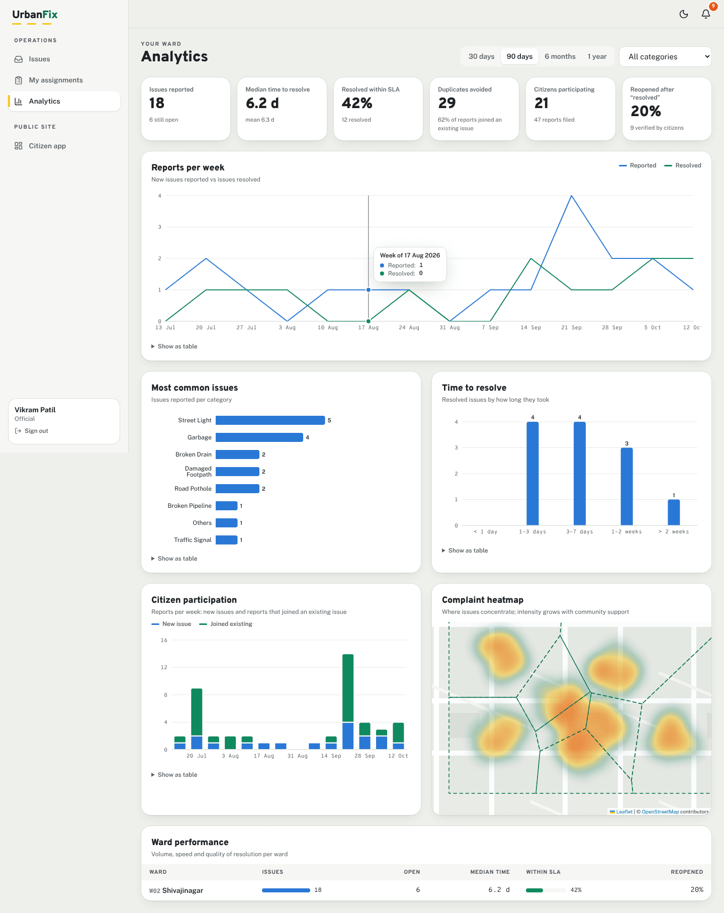
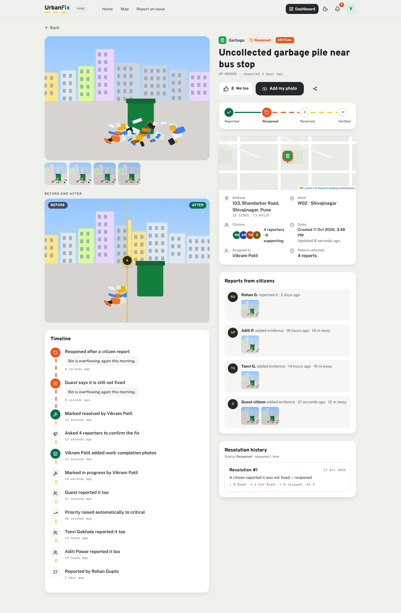

# UrbanFix

Citizens photograph a broken road, an overflowing bin or a dead street light. UrbanFix pins the location, sorts the
report into a category, checks whether a neighbour already reported the same problem, and sends it to the Municipal
Corporation. Officials triage, assign and resolve it with proof, and the citizens who reported it confirm the fix
before it is closed.

<table>
  <tr>
    <td width="25%"></td>
    <td width="25%"></td>
    <td width="25%"></td>
    <td width="25%"></td>
  </tr>
</table>

<table>
  <tr>
    <td width="50%"></td>
    <td width="50%"></td>
  </tr>
</table>

<sub>Screenshots are generated by <code>pnpm screenshots</code> (the end-to-end test) against the demo seed. The seed photos are generated illustrations, not real streets.</sub>

## What it does

**For citizens** (sign in, or continue as a guest and upgrade later)

- **Report in about a minute.** Take or upload up to 4 photos. They are compressed in the browser, and the location comes
  from GPS, with the photo's EXIF location or a draggable map pin as fallbacks. The address is reverse-geocoded.
  Gemini suggests the category, a title, a description and a severity, and screens the photo.
- **Duplicate check before submitting.** Example: _"There is already an open Garbage issue reported 12 meters away."_
  The citizen can **Join this issue**, which attaches their photo as evidence, makes them a reporter and raises its
  support and priority, or **Create new issue** if it really is different. The API enforces the check too.
- **Follow the issue.** Each issue page has photos, a status stepper, a timeline, a before/after slider, the location,
  ward, reporter and supporter counts, attached reports, dates and the resolution history. "Me too" adds support
  without a photo.
- **Confirm the fix.** When officials mark an issue resolved, every reporter is asked: ✅ It's fixed / ❌ Still not
  fixed (requires a new photo, plus an optional comment) / ⏭ Skip. One "still not fixed" reopens the issue and alerts
  officials. Enough confirmations mark it **Verified**.
- **Profile.** Submitted and joined reports, resolution history, contribution stats, a reputation score with levels,
  and badges.

**For the Municipal Corporation**

- **Dashboard.** KPIs (open, unassigned, past SLA, resolved this week, average time to resolve), a filterable table and
  map side by side, filters for category, status, priority, ward, date range and past-SLA, and search by text or
  `UF-000123`. Filters live in the URL, so a view can be shared.
- **Triage and work.** Assign to field staff, move through a strict status machine (Pending, In progress, Resolved,
  Rejected, and Reopened or Verified by the citizens), override priority, add internal notes, upload
  work-completion photos (required before resolving), and merge duplicates.
- **Analytics.** Reports per day or week, distribution of resolution time, most common categories, ward performance
  (median time, SLA compliance, reopen rate), citizen participation including duplicates avoided, and a complaint
  heatmap.
- **Admin.** People and roles (citizen, field staff, official, admin; ward-scoped or city-wide), categories (icon,
  colour, SLA, duplicate radius, related categories), wards (GeoJSON boundaries), a moderation queue for photos flagged
  by AI, verification settings, and an audit log.

**Across the app:** real-time notifications (Socket.IO and Web Push), an installable PWA, mobile-first layouts, dark
mode, keyboard and screen-reader support, and `prefers-reduced-motion` respected.

## Architecture

```
 Browser (React SPA / PWA) ──HTTPS──▶ nginx ──/api /uploads /socket.io──▶ API (Fastify, N replicas)
                                                                          │  ├─ PostgreSQL 16 + PostGIS + pg_trgm
                                                                          │  ├─ Redis: BullMQ, rate limits, Socket.IO adapter, caches
                                                                          │  └─ Storage: local volume or S3 / R2 / MinIO
                                       Worker (BullMQ) ───────────────────┘── Gemini API · Nominatim · Web Push
```

| Layer  | Choices                                                                                                                                                                                                   |
| ------ | --------------------------------------------------------------------------------------------------------------------------------------------------------------------------------------------------------- |
| Web    | React 19, Vite, Tailwind CSS v4, Motion, TanStack Query, React Router, Leaflet + supercluster + leaflet.heat, Recharts, Radix UI, vite-plugin-pwa                                                         |
| API    | Fastify 5 with zod validation and OpenAPI (`/api/docs`), Drizzle ORM on PostgreSQL/PostGIS, argon2, JWT access tokens and rotating refresh tokens, sharp image pipeline, Socket.IO with the Redis adapter |
| Jobs   | BullMQ worker: AI photo analysis, notification fan-out, verification deadlines, SLA alerts, analytics refresh, upload cleanup                                                                             |
| AI     | Google Gemini (AI Studio): vision analysis and multimodal embeddings, with model fallback, retries, a circuit breaker and offline heuristics                                                              |
| Shared | `@urbanfix/shared`: zod schemas, response types, the status machine, and the duplicate-scoring, priority, verification and gamification rules (all unit-tested)                                           |

More detail: [docs/architecture.md](docs/architecture.md) · [docs/data-model.md](docs/data-model.md) ·
[docs/api.md](docs/api.md) · [docs/duplicate-detection.md](docs/duplicate-detection.md)

```
UrbanFix/
├── apps/
│   ├── api/                 Fastify API + worker
│   │   ├── src/
│   │   │   ├── core/        config, auth, RBAC, errors, jobs, realtime, storage, redis, logger
│   │   │   ├── db/          Drizzle schema, migrations runner, demo seed
│   │   │   ├── modules/     auth · uploads · issues · duplicates · manage · verification ·
│   │   │   │                notifications · gamification · me · admin · analytics · ai · geo
│   │   │   ├── jobs/        job registry and maintenance jobs
│   │   │   ├── server.ts    HTTP + Socket.IO entrypoint
│   │   │   └── worker.ts    BullMQ worker entrypoint
│   │   ├── drizzle/         SQL migrations (PostGIS, generated columns, materialized view)
│   │   └── test/            unit + integration tests
│   └── web/                 React app
│       ├── src/
│       │   ├── app/         router, layouts, guards
│       │   ├── components/  UI kit (lane line, stepper, sheet, …) and map components
│       │   ├── features/    report · issues · map · profile · notifications · verify ·
│       │   │                dashboard · analytics · admin · auth · home
│       │   └── lib/         API client, auth store, realtime, geolocation, image prep
│       └── e2e/             Playwright smoke test
├── packages/shared/         domain rules, schemas and types shared by API and web
├── infra/docker/            Dockerfiles, nginx config
├── docker-compose.yml       full stack
└── docker-compose.dev.yml   Postgres + Redis for local development
```

## Quick start with Docker

```bash
cp .env.example .env
# Set JWT_ACCESS_SECRET (e.g. `openssl rand -base64 48`) and optionally GEMINI_API_KEY
docker compose up -d --build
docker compose --profile demo run --rm seed    # optional: demo city with ~160 issues
```

Open <http://localhost:8080>. The compose stack runs PostGIS, Redis, a one-shot migration, the API, the worker and nginx
serving the web app.

## Local development

Requirements: Node 22+, pnpm 10, and PostgreSQL 16 with PostGIS plus Redis 7 (or Docker for those two).

```bash
pnpm install
docker compose -f docker-compose.dev.yml up -d   # Postgres + PostGIS (and a test DB) + Redis
cp apps/api/.env.example apps/api/.env           # add GEMINI_API_KEY to enable AI
pnpm db:migrate
pnpm db:seed                                     # demo data (about 90 s; generates photos)
pnpm dev                                         # API on :4000, web on :5173
```

`apps/api/.env.example` uses `JOBS_MODE=inline`, which runs background jobs inside the API process. To run them on
BullMQ, as in production, set `JOBS_MODE=queue` and also run `pnpm dev:worker`. Swagger UI is at
<http://localhost:4000/api/docs>.

### Demo accounts

All demo accounts use the password `urbanfix123`. In development the login page lists them under "Demo accounts".

| Role                         | Email                                  |
| ---------------------------- | -------------------------------------- |
| Citizen                      | `citizen@urbanfix.local`               |
| Ward official (Shivajinagar) | `official.shivajinagar@urbanfix.local` |
| City-wide official           | `official@urbanfix.local`              |
| Field staff (Shivajinagar)   | `staff@urbanfix.local`                 |
| Administrator                | `admin@urbanfix.local`                 |

To see duplicate detection, report **Garbage** at `18.52315, 73.8413`. There is a seeded open garbage issue 12 m away.

## AI integration (Gemini)

Set `GEMINI_API_KEY` to a [Google AI Studio](https://aistudio.google.com/) key. With the key set, each uploaded
citizen photo gets the following in the background:

- **One multimodal call** returning category (with confidence and alternatives), caption/title, description
  suggestion, severity (1–5) with a reason, suggested priority, moderation flags (nsfw, violence, PII, not a civic
  issue, …) and OCR of signboards and landmarks. The output is constrained to a JSON schema, validated with zod, and
  text inside the image is treated strictly as data.
- **A 768-dimension multimodal image embedding**, used to compare photos during duplicate detection.

The client tries each model in `GEMINI_MODELS` in order (default
`gemini-flash-latest,gemini-flash-lite-latest`). It retries transient errors with backoff and opens a circuit breaker
after repeated failures. Without a key, or during an outage, everything still works: categories come from keyword
heuristics (English and common Hindi/Hinglish words), duplicate detection relies on location, category, perceptual
hashes and text, and unscreened reports land in the moderation queue. `pnpm --filter @urbanfix/api ai:smoke` checks a
key end to end.

## How duplicate detection works

PostGIS finds open issues within a category-specific radius, which is widened for poor GPS accuracy. Each candidate
is then scored on five signals:

| Signal   | Weight | Source                                               |
| -------- | ------ | ---------------------------------------------------- |
| Distance | 0.35   | Gaussian decay within the search radius              |
| Category | 0.25   | Same, or related (e.g. drain ↔ leak ↔ pipeline)      |
| Photo    | 0.25   | SHA-256, perceptual hash and Gemini image embeddings |
| Text     | 0.10   | pg_trgm similarity of descriptions and AI captions   |
| Recency  | 0.05   | Recent activity                                      |

Signals that are unavailable don't count against a candidate. A score of 0.75 or more is **Likely the same**; the API
then refuses to create a new issue (HTTP 409) until the citizen has seen and dismissed the match. A score from 0.5 to
0.75 is shown as **Possibly the same**. Officials can still merge duplicates afterwards. Weights, thresholds and
calibration are in [docs/duplicate-detection.md](docs/duplicate-detection.md).

## Testing

```bash
pnpm lint && pnpm typecheck
pnpm test               # unit: shared rules (scoring, status machine, verification…), API helpers, web components
pnpm test:integration   # API against real Postgres/PostGIS + Redis (needs the urbanfix_test database)
pnpm test:e2e           # browser smoke test of the full loop; needs API + web running on a fresh seed
```

The end-to-end test follows a guest reporting garbage next to an existing issue. Duplicate detection offers the
existing issue and the guest joins it. The ward official then starts work, uploads a completion photo and resolves
it. The guest answers "Still not fixed" with a photo, and the official receives the reopen notification in real time.
CI (`.github/workflows/ci.yml`) runs lint, typecheck, unit tests, builds, the integration tests against PostGIS and
Redis service containers, and both Docker image builds.

## Configuration

The main API settings are below. All of them are validated at startup; see `apps/api/src/config.ts` for the full
list.

| Variable                                        | Purpose                                                                      |
| ----------------------------------------------- | ---------------------------------------------------------------------------- |
| `DATABASE_URL`, `REDIS_URL`                     | PostgreSQL (with PostGIS) and Redis                                          |
| `JWT_ACCESS_SECRET`                             | 32+ random characters; required in production                                |
| `PUBLIC_API_URL`, `WEB_ORIGIN`                  | Public origin for photo URLs; allowed browser origins (CORS and Socket.IO)   |
| `COOKIE_SECURE`                                 | `true` behind HTTPS (the default in production)                              |
| `JOBS_MODE`                                     | `queue` (BullMQ worker) or `inline` (single process)                         |
| `WEB_DIST_DIR`                                  | Built web app to serve from the API (single-container deploys)               |
| `STORAGE_DRIVER`, `S3_*`                        | `local` volume or S3-compatible object storage                               |
| `GEMINI_API_KEY`, `GEMINI_MODELS`, `AI_ENABLED` | AI analysis                                                                  |
| `GEOCODER_URL`, `GEOCODER_EMAIL`                | Nominatim-compatible reverse geocoding (cached and throttled to 1 request/s) |
| `VAPID_PUBLIC_KEY`, `VAPID_PRIVATE_KEY`         | Web Push (`npx web-push generate-vapid-keys`)                                |
| `CITY_NAME`, `CITY_LAT`, `CITY_LNG`             | Default map centre and seed city                                             |

Web build variables: `VITE_API_URL` (empty means same origin), `VITE_MAP_TILE_URL`, `VITE_MAP_ATTRIBUTION`,
`VITE_SHOW_DEMO_ACCOUNTS`.

Admins can change the verification rules at runtime in **Admin → Settings**: the window, the number and share of
confirmations required, whether a completion photo is required, and auto-verify on silence.

## Deploy for free

[docs/deploy-free.md](docs/deploy-free.md) walks through a no-cost deploy, no credit card needed:

- one Render web service built from `infra/docker/app.Dockerfile`, defined in [`render.yaml`](render.yaml), which
  serves the web app, the API and the background jobs;
- Neon for Postgres + PostGIS;
- Upstash for Redis;
- Supabase Storage for photos.

## Deploying to production

- **TLS and cookies.** Terminate TLS in front of nginx (Caddy, Traefik, or a cloud load balancer). Set
  `COOKIE_SECURE=true`, `PUBLIC_API_URL=https://…` and `WEB_ORIGIN=https://…`.
- **Secrets.** Generate a strong `JWT_ACCESS_SECRET` and keep all secrets in your platform's secret store, never in
  the repository.
- **Database and Redis.** Use managed PostgreSQL with PostGIS (RDS, Cloud SQL, Neon, Supabase…) and managed Redis.
  Migrations run from the `migrate` service; run it once per deploy.
- **Storage.** Use `STORAGE_DRIVER=s3` with S3, R2 or MinIO behind a CDN (`S3_PUBLIC_URL`).
- **Scaling.** The API is stateless (JWT plus a Redis-backed Socket.IO adapter), so run several replicas behind the
  proxy. Scale the worker separately; the AI queue concurrency defaults to 2 to respect free-tier rate limits.
- **Maps and geocoding.** Use a tile provider (MapTiler, Stadia, Carto) or self-hosted tiles via `VITE_MAP_TILE_URL`;
  the public OSM tile servers are for light use only. For reverse geocoding, follow the
  [Nominatim usage policy](https://operations.osmfoundation.org/policies/nominatim/) by setting `GEOCODER_EMAIL`, or
  self-host Nominatim.
- **Push notifications.** Set VAPID keys to enable Web Push.
- **Backups and monitoring.** Back up Postgres and the uploads volume or bucket. Logs are JSON (pino) with request
  IDs, ready for any log stack. `/healthz` is a liveness check and `/readyz` checks the DB and Redis.

## Security

- **Passwords and sessions.** Passwords are hashed with argon2id, and failed logins take the same time whether or not
  the email exists. Access tokens last 15 minutes. Refresh tokens are rotating httpOnly cookies with reuse detection,
  which revokes the whole session family, and they require a CSRF header.
- **Authorization.** Role-based access is checked per route and per resource: ward-scoped officials see only their
  ward, and staff can work only on issues assigned to them. Admin and official actions are written to an audit log.
- **Input validation.** Every input is validated with zod. Uploads are checked by magic bytes and size, re-encoded,
  and stripped of EXIF metadata (GPS is read first).
- **HTTP protections.** Helmet, a CORS allowlist, Redis-backed rate limits (stricter for guests and auth endpoints),
  and security headers set in nginx.
- **Privacy.** The public pages show reporters as first name and last initial; reporter details are visible only to
  officials. API keys are only ever sent in headers and are redacted from logs.
