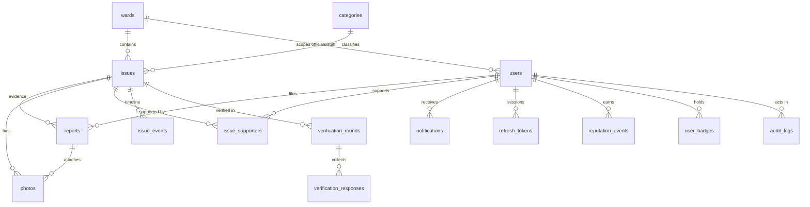

# Data model

PostgreSQL 16 with **PostGIS**, **pg_trgm** and **citext**. The schema is in `apps/api/src/db/schema.ts` (Drizzle,
snake_case columns) and the migrations in `apps/api/drizzle/`.

## Core tables

| Table                    | Purpose and key columns                                                                                                                                                                                                                                                                                                                                                                                                                            |
| ------------------------ | -------------------------------------------------------------------------------------------------------------------------------------------------------------------------------------------------------------------------------------------------------------------------------------------------------------------------------------------------------------------------------------------------------------------------------------------------- |
| `issues`                 | One civic problem. `ref_no` (shown as `UF-000123`), `status`, `priority` + `priority_locked`, `severity`, `title` (AI caption), `lat`/`lng`, plus `location geography(Point)` **generated from lat/lng**, `address`, denormalised `support_count`/`report_count`/`reporter_count`, `assignee_id`, `ward_id`, `sla_due_at`, `resolved_at`, `verified_at`, `reopened_count`, `merged_into_id`, `last_activity_at`, and a generated `search tsvector` |
| `reports`                | One citizen submission: the original (`NEW`), joined evidence (`JOINED`) or moved by a merge (`MERGED`). Location and accuracy, description, AI analysis, `moderation_status`, `duplicate_override` (matches the citizen dismissed). Unique per (issue, reporter).                                                                                                                                                                                 |
| `photos`                 | Uploaded images. `kind` (report, work completion, verification), `status` (draft, attached, hidden), WebP `variants` (thumb 320 / medium 960 / full 2048), `thumbhash`, `sha256`, `phash` (64-bit hex), `embedding real[]` (768-dim), EXIF location, `analysis` JSON                                                                                                                                                                               |
| `issue_supporters`       | Everyone backing an issue, reporters included (`is_reporter`); `support_count` mirrors its row count                                                                                                                                                                                                                                                                                                                                               |
| `issue_events`           | The timeline: created, joined, status changed, assigned, priority/category changed, work photos added, verification requested/answered, reopened, verified, merged, moderated. `is_internal` marks staff-only notes.                                                                                                                                                                                                                               |
| `verification_rounds`    | One per resolution: `closes_at`, `eligible_count`, `outcome` (pending, verified, reopened, expired)                                                                                                                                                                                                                                                                                                                                                |
| `verification_responses` | One per citizen per round: resolved / not fixed / skipped, comment, photo IDs                                                                                                                                                                                                                                                                                                                                                                      |

## People, configuration and audit

| Table                              | Purpose                                                                                                                                                                 |
| ---------------------------------- | ----------------------------------------------------------------------------------------------------------------------------------------------------------------------- |
| `users`                            | `role` (citizen, staff, official, admin), `is_guest`, `ward_id` (null means city-wide), `reputation`, `status`, notification preferences. Email is `citext` and unique. |
| `refresh_tokens`                   | Hashed rotating refresh tokens grouped by `family_id` for reuse detection                                                                                               |
| `push_subscriptions`               | Web Push endpoints                                                                                                                                                      |
| `categories`                       | Name, icon, colour, default priority, SLA hours, duplicate radius, related categories, active flag                                                                      |
| `wards`                            | Code, name, `boundary geometry(MultiPolygon)` and a centre point. Issues are assigned with `ST_Contains`, falling back to the nearest centre within 10 km.              |
| `notifications`                    | In-app inbox (and the source for socket and Web Push delivery)                                                                                                          |
| `reputation_events`, `user_badges` | Auditable, idempotent reputation (unique per user/reason/reference) and earned badges                                                                                   |
| `audit_logs`                       | Who changed what, from which IP                                                                                                                                         |
| `app_settings`                     | Admin-editable verification settings                                                                                                                                    |
| `geocode_cache`                    | Reverse-geocoding results per ~11 m cell                                                                                                                                |

## Indexes and generated data

- GiST on `issues.location` and `reports.location` for radius and bounding-box queries; GiST on `wards.boundary`.
- btree on (`status`, `category_id`), `ward_id`, `assignee_id`, `created_at`; partial indexes for unread
  notifications and pending verification rounds.
- GIN on `issues.search` (full-text over the reference, title, description and address) and a trigram index on
  `issues.title`.
- The materialized view `daily_issue_stats` holds per-day, per-ward, per-category created and resolved counts, SLA
  hits and resolution hours. The worker refreshes it concurrently every 15 minutes.
